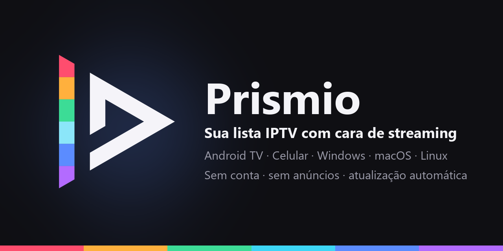

  

# Prismio

**Seu conteúdo, com cara de streaming.** O Prismio é um player de listas IPTV para a TV, o celular e o computador. Você aponta para a lista do seu provedor e ele a transforma numa biblioteca bonita e organizada: capas, sinopses, elenco, guia de programação e tudo pronto para assistir com o controle remoto, o toque ou o mouse.

O Prismio é só o reprodutor. Ele **não fornece nenhum conteúdo**: você usa a lista que já tem.

## O que ele faz

- **Cara de streaming.** Início com destaques, fileiras de filmes, séries e canais, Top 10 e recomendações a partir do que você curte.
- **Filmes e séries completos.** Capas, sinopses, nota, classificação indicativa, duração, gêneros e episódios organizados por temporada. Abre de onde você parou e vai para o próximo episódio sozinho, com botão de pular a abertura.
- **Elenco.** Toque em um ator para ver foto, biografia e prêmios, e quais títulos dele estão na sua lista.
- **TV ao vivo.** Canais por categoria, prévia ao lado da lista, guia de programação com o que passa agora e o que vem a seguir, grade completa e lembretes de programas.
- **Um canal só.** As versões do mesmo canal (Full HD, HD, SD) aparecem como um canal, e o Prismio troca sozinho se uma delas falhar.
- **Perfis para a família.** Cada pessoa tem os próprios favoritos, histórico e curtidas, com senha opcional e perfil infantil que esconde o conteúdo adulto.
- **Seus aparelhos em sincronia.** Comece o filme na TV e continue no computador, na mesma rede, sem nuvem e sem conta.
- **Legendas.** Busca de legendas em português para filmes e séries.
- **Busca rápida** por canais, filmes e séries, na tela inteira ou só no que você escolher.
- **Leve e sem anúncios.** Não pede conta, não tem anúncios e guarda suas listas só nos seus aparelhos.

## Baixar

A versão mais recente fica sempre na página de **[Releases](https://github.com/ajotanc/Prismio-releases/releases/latest)**. Todos os arquivos levam a versão e a plataforma no nome, para você saber de qual build cada um é:

| Sistema | Arquivo |
|---|---|
| **Android TV e celular** | `Prismio_<versão>.apk` |
| **Windows** | `Prismio_<versão>_x64-setup.exe` (instalador) ou `Prismio_<versão>_x64.msi` |
| **macOS** | `Prismio_<versão>_universal.dmg` (Apple Silicon e Intel) |
| **Linux** | `Prismio_<versão>_x86_64.AppImage`, `Prismio_<versão>_amd64.deb`, `Prismio_<versão>_x86_64.rpm` ou `Prismio_<versão>_x64.tar.gz` |

O site oficial também tem os botões de download, já escolhendo o sistema certo para você: **[prismio.ajotanc.com.br](https://prismio.ajotanc.com.br)**.

### Instalando

- **Android TV e celular:** abra o arquivo e permita instalar apps de fora da loja quando o Android pedir.
- **Windows:** execute o instalador. Se o Windows mostrar um aviso de aplicativo desconhecido, escolha "Mais informações" e depois "Executar assim mesmo".
- **macOS:** abra o arquivo, arraste o Prismio para Aplicativos e, na primeira vez, escolha "Abrir mesmo assim" em Ajustes > Privacidade e Segurança.
- **Linux:** no AppImage, marque o arquivo como executável e abra. No pacote .deb (Debian, Ubuntu e derivadas) ou .rpm (Fedora, openSUSE), instale pelo gerenciador de pacotes. No .tar.gz, descompacte e abra o Prismio.

### Atualizações

O app de computador se atualiza sozinho: ao abrir, ele procura a versão nova e avisa quando está pronta. No Android, baixe o arquivo novo desta página e instale por cima.

## Privacidade

Suas listas, seu login do provedor, favoritos e histórico ficam **somente nos seus aparelhos**. O Prismio não envia essas informações para nenhum servidor nosso. Os textos completos estão no site, em [Privacidade](https://prismio.ajotanc.com.br/privacy) e [Termos de uso](https://prismio.ajotanc.com.br/terms).

---

Este repositório contém só os instaladores. O Prismio é um projeto independente e não tem relação com provedores de conteúdo.
